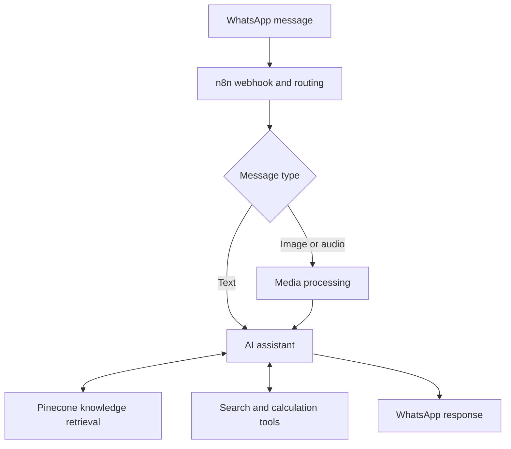

# WhatsApp AI Agent

A multi-modal WhatsApp assistant built with **n8n**, integrating conversational AI, media handling, web search/calculation tools, and retrieval from a Pinecone knowledge base.

> Portfolio project: demonstrates workflow orchestration and third-party API integration. This repository contains a workflow export; it is not a hosted service.

## At a glance

| Area | Implementation |
|---|---|
| Orchestration | n8n |
| Messaging | WhatsApp Business Cloud |
| AI | OpenAI |
| Knowledge retrieval | Pinecone |
| Additional capabilities | Web search, calculations, image/audio message handling |
| Workflow export | `WhatsApp_Agent.json` — 27 nodes |

## Architecture

The diagram is a conceptual view of the documented capabilities; configure and verify each provider integration in your own n8n instance.

## Repository contents

- `WhatsApp_Agent.json` — importable 27-node n8n workflow export.

## Requirements

- A compatible n8n instance.
- WhatsApp Business Cloud app, phone number, and webhook configuration.
- OpenAI API access.
- Pinecone index.
- SERP/search API access and any required MCP server endpoint.

## Setup

1. Import `WhatsApp_Agent.json` into n8n.
2. Create your own n8n credentials for WhatsApp, OpenAI, search, Pinecone, and authenticated media requests.
3. Assign the credentials to the corresponding nodes.
4. Configure your phone-number ID, test recipient, media endpoint, Pinecone index, and MCP endpoint.
5. Configure the Meta webhook and test with a non-production number before activation.

Never commit API keys, access tokens, webhook secrets, or real customer data. Use n8n's credential store or an appropriate secret manager.

## Validation status

- Repository includes a sanitized workflow export.
- A live end-to-end run against Meta, OpenAI, Pinecone, and the search provider is **not asserted by this README**.
- Verify media download/binary handling, audio generation, provider limits, and failure paths in your own environment.

## Limitations and next steps

- Provider credentials and external services are not included.
- Node behavior can vary with provider API versions and n8n node versions.
- Add a short redacted execution demo and test evidence after runtime verification.

## License

No license is specified. Contact the repository owner before reusing this project.
